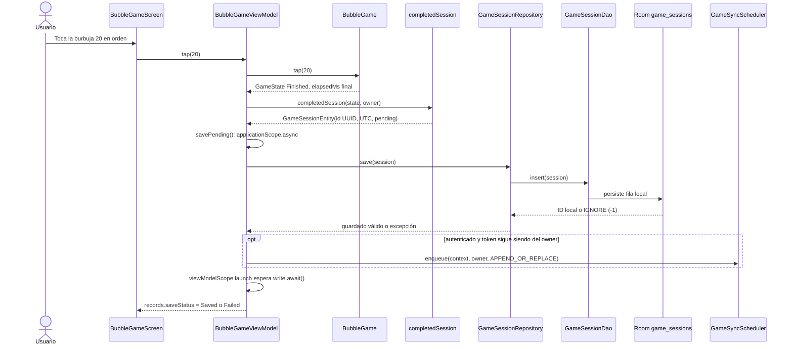
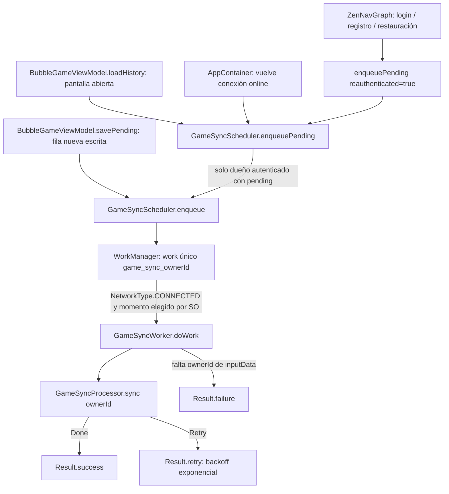
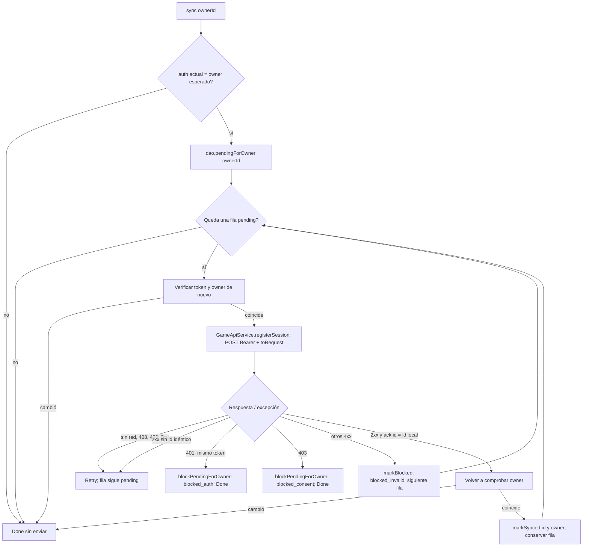

# Flujos reales: de la pulsación a las estadísticas

Los diagramas representan **llamadas existentes**, no funciones que habría que implementar. La línea discontinua indica retorno/estado observable; WorkManager no promete ejecución inmediata. Rutas de clases bajo `features/games/`, salvo cuando se indica `ZenNavGraph`, `AppContainer`, `AppDatabase` o `ZenMindApplication`.

## A. Entrar, comenzar, acertar y equivocarse

```mermaid
sequenceDiagram
    actor Usuario
    participant Nav as ZenNavGraph
    participant Screen as BubbleGameScreen
    participant VM as BubbleGameViewModel
    participant Model as BubbleGame
    Usuario->>Nav: Toca HomeFeature.GAMES
    Nav->>Screen: Routes.GAMES, onBack
    Screen->>VM: Factory crea ViewModel; recoge uiState y records
    Screen->>VM: resize(width, height) en dp
    VM->>Model: resize(width, height)
    Usuario->>Screen: Pulsa Empezar
    Screen->>VM: start()
    VM->>Model: start()
    Model->>Model: place(1..20), startedAt = clock()
    Model-->>VM: state Running, 20 burbujas
    VM-->>Screen: uiState StateFlow
    Usuario->>Screen: Pulsa número n
    Screen->>VM: tap(n)
    VM->>Model: tap(n)
    alt n es incorrecto
        Model->>Model: errors + 1; place(restantes, previas)
    else n es correcto
        Model->>Model: elimina n; correctTaps + 1; nextNumber + 1
    end
    Model-->>VM: state actualizado
    VM-->>Screen: uiState actualizado
```

1. `BubbleGameScreen` recibe ancho y alto reales del tablero (`BoxWithConstraints`), expresados en dp; `BubbleGame.resize` establece tamaño y, si procede, reubica lo que quede.
2. `BubbleGame.start` no hace nada si ya está Running/Paused o no caben las 20 burbujas. Si puede iniciar, distribuye 1..20, reinicia contadores y guarda `startedAt` del reloj monotónico.
3. `tap(n)` primero exige fase Running y una burbuja existente; ignora un segundo toque al mismo número dentro de 250 ms. Error ⇒ incrementa contador y redistribuye; acierto ⇒ quita número y adelanta progreso.
4. La UI no decide el resultado: el ViewModel lee `game.state` y lo publica por `uiState`. El `LaunchedEffect` llama `tick()` cada 250 ms mientras la pantalla esté STARTED; `tick` solo actualiza `displayMs`.
5. `LifecycleEventEffect(ON_STOP)` llama `pause()`, que acumula tiempo; `resume()` inicia otro tramo. `elapsedRealtime` mide duración sin depender del reloj civil.

## B. Acertar 20, crear sesión y guardar antes de enviar



1. El ViewModel compara la fase **anterior** y la fase **posterior** a `game.tap`: construye `pendingSession` solo en la transición a Finished. No genera un UUID por recomposición ni por retry.
2. `completedSession` exige 20 aciertos, genera `UUID.randomUUID().toString()`, guarda resultados en milisegundos, fecha ISO8601 UTC y `GameOwner`. Invitado ⇒ `isGuest=true` y owner local `guest`.
3. `GameSessionRepository.save` ejecuta la escritura en IO. `insert(IGNORE)` evita dos filas con la misma clave; si devolvió `-1`, `byId` debe encontrar **la misma** sesión para considerar válido el reintento.
4. **Solo después** de completar `repository.save`, el bloque del `applicationScope.async` puede intentar agendar envío de una cuenta autenticada. Fallar al agendar no convierte una escritura Room exitosa en «no guardada».
5. `write.await()` permite que la pantalla diga Saved cuando se confirma la escritura y Failed cuando falla. Si el ViewModel desaparece, se cancela la espera, **no necesariamente la escritura** que ya corre en el scope de aplicación. No se promete supervivencia ante matar el proceso antes de que Room escriba.

## C. Quién encola y qué hace el trabajo de red



`enqueuePending` comprueba owner y `pendingForOwner`. Con `reauthenticated=true` restaura **solo** las filas `blocked_auth` de ese owner a `pending` después de autenticar. `enqueue` usa `KEEP` por defecto para no programar otro trabajo redundante; después de guardar una nueva sesión se usa `APPEND_OR_REPLACE` para no perder un trabajo que llegó mientras otro estaba en curso. WorkManager exige red y backoff de base 30 segundos: no equivale a «el servidor está disponible» ni a «se ejecutará exactamente dentro de 30 segundos».

### Dentro de `GameSyncProcessor.sync(ownerId)`



El diagrama agrupa comprobaciones para legibilidad: **en código la identidad se revisa después de recibir cualquier respuesta y antes del `when` HTTP**; si un 401 llega tras renovar el token del **mismo** owner, devuelve `Retry` en vez de bloquear. Un `CancellationException` se vuelve a lanzar. Un 2xx sin el mismo UUID **no** prueba que la partida local llegó. Un `400`/otro 4xx permanente no provoca reintentos sin límite.

**Pérdida de respuesta tras POST:** aunque el backend haya creado la fila, el cliente no recibe `ack.id`; conserva el UUID local pendiente y reintenta. `juegos.service.ts` retorna la sesión existente si el mismo UUID ya pertenece al mismo usuario; así evita duplicación remota.

## D. GET remoto, Room como caché y estadísticas

```mermaid
sequenceDiagram
    actor Usuario
    participant Screen as BubbleGameScreen
    participant VM as BubbleGameViewModel
    participant Repo as GameSessionRepository
    participant DAO as GameSessionDao
    participant GET as GameApiService.listSessions
    participant Refresh as GameHistoryRefresher.refresh
    participant Stats as calculateGameStatistics
    Usuario->>Screen: Abre Juegos
    Screen->>VM: Factory; init llama loadHistory()
    VM->>Repo: currentOwner()
    Repo-->>VM: GameOwner
    VM->>Repo: observeHistory(owner)
    Repo->>DAO: observeForOwner(owner.id, owner.isGuest)
    DAO-->>VM: Flow: historial local inicial y cambios
    VM->>Stats: withContext(Default): calculateGameStatistics(history, owner)
    Stats-->>VM: GameStatistics
    VM-->>Screen: records: estadísticas e historial
    opt usuario autenticado
        VM->>Repo: refreshFromBackend(owner)
        Repo->>Refresh: refresh(owner) en IO
        Refresh->>GET: GET /api/v1/juegos/sesiones con Bearer
        GET-->>Refresh: Response de sesiones
        Refresh->>DAO: byId / insert / markConfirmedByHistory
        DAO-->>VM: Flow emite historial actualizado
        VM->>Stats: collectLatest + withContext(Default)
        VM-->>Screen: records actualizado
    end
```

**Paso a paso:** `loadHistory()` arranca trabajos separados: el `Flow` de Room proporciona la lista local, `GameSyncScheduler.running()` observa si el worker está ejecutándose y un trabajo `viewModelScope` hace el GET si el owner no es invitado. Esos trabajos pueden solaparse: la UI no espera HTTP para mostrar Room. **El orden de flechas es didáctico; el código lanza GET y la observación local concurrentemente, así que no promete que la primera emisión de Room preceda a una respuesta GET muy rápida.** El refrescador valida `usuarioId`, formato UUID, métricas, fecha y owner actual. Si falta un ID lo inserta `synced`; si ya existe, solo confirma la fila cuando coinciden propietario, fecha y resultados. Si el GET falla, el ViewModel muestra mensaje y no borra el historial local.

`observeHistory(owner).collectLatest` vuelve a calcular sobre el **historial completo filtrado** al cambiar filas locales o estados de sincronización. `calculateGameStatistics` corre en `Dispatchers.Default`; la UI recibe los valores por `records` (`StateFlow`). `BubbleGameScreen` muestra estadísticas y **solo las últimas cinco filas**; no calcula promedios a partir de esas cinco. Precisión = `Σaciertos / (Σaciertos + Σerrores)`; denominador 0 ⇒ 0. Internamente se conservan milisegundos; `formatTime` y `formatStatsTime` solo transforman presentación.

## E. Escenarios que conectan todos los flujos

| Escenario | Qué se observa / qué persiste |
|---|---|
| Primera apertura sin partidas ni red | Room emite lista vacía; pantalla muestra estado vacío. Invitado no hace GET ni POST. |
| Autenticado completa offline | Room guarda `pending`; WorkManager espera condición de conectividad; estadísticas incluyen la partida local sin esperar servidor. |
| Falla backend temporalmente | GET fallido mantiene historial local; POST/worker deja fila `pending` y `Result.retry()` con backoff. |
| Red restaurada | `AppContainer` puede pedir encolar pendientes; WorkManager elige cuándo ejecutar; Room emite cambio a `synced` tras confirmación. |
| Cambio a otra cuenta | `ownerId` e `isGuest` filtran historial y estadísticas; worker/refresco revisan identidad antes y después de red. Invitados nunca se reasignan automáticamente. |
| Mismo UUID local y remoto | `byId` y la clave primaria evitan otra fila; solo datos equivalentes se confirman; estadísticas también aplican `distinctBy(id)`. |
